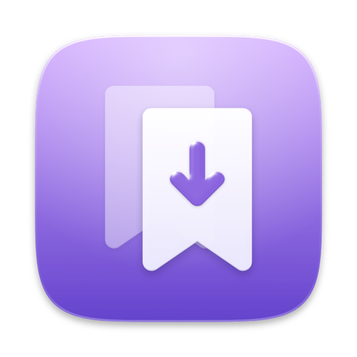

<p align="center">
  
</p>

<h1 align="center">wroopmark</h1>

<p align="center">
  Kaydettiklerin, çevrimdışı ve aranabilir. macOS için.<br>
  <a href="https://github.com/f0rknturkoglu/wroopmark/releases/latest">İndir</a> ·
  <a href="#kurulum-macos-14">Kurulum</a> ·
  <a href="#kullanım">Kullanım</a> ·
  <a href="ARCHITECTURE.md">Mimari</a>
</p>

---

Sosyal medyada kaydettiklerin (X yer imleri, TikTok favorileri, Instagram ve
Reddit kaydedilenleri, herhangi bir web sayfası) tek yerde, **çevrimdışı**
ve aranabilir. Metin, görseller, videolar ve linkler Mac'ine iner; gönderi
kaynağından silinse de arşivde kalır.

Sunucu, Docker, hesap yok. Rust çekirdeği + SwiftUI macOS uygulaması +
Chromium/Safari eklentisi; hepsi tek bir yerel kütüphaneyi kullanır.

## Neler yapar

**Arşiv**
- X, TikTok, Instagram, Reddit ve her web sayfası tek bir kayıt biçiminde.
- Medya bir kez iner (aynı görsel iki gönderide olsa da); TikTok videoları
  yt-dlp ile arka planda.
- Görsellerdeki yazı cihazda okunur (Apple Vision), ekran görüntüleri de aranır.
- Yedek: veritabanı + medya + düz bir dışa aktarım (`items.jsonl`), istenirse her gün.

**Bulmak**
- Tek arama kutusu: `rust tag:dev -from:@jack has:image after:2024 "tam ifade"`;
  Türkçe katlama ("istanbul" = "İSTANBUL" = "ıstanbul").
- Filtre paneli (platform, medya, klasör, etiket, kişi, tarih…), kayıtlı aramalar.
- Spotlight'ta da çıkar; seçince kayıt uygulamada açılır.
- Kart, liste, akış görünümleri; foto ve video galerisi.

**Düzen**
- Klasörler (alt klasörlerle), hiyerarşik etiketler (`dev/rust`), notlar.
- Ayıkla: kayıtlar tek tek gelir, ← sil, → sakla, 1–3 önerilen klasöre taşı.
- Link havuzu: gönderilerdeki tüm linkler tekilleştirilmiş, kırık olanlar işaretli.

**Hızlı kayıt**
- Menü çubuğundan link kaydet; her uygulamada ⌃⌥⌘S panodaki linki kaydeder.
- Eklentide ⌥⇧S, sağ tıkla klasöre kaydet; arşivdeki sayfalarda simgede ✓.

## Kurulum (macOS 26+)

### Tek komut

```bash
git clone https://github.com/f0rknturkoglu/wroopmark.git
cd wroopmark
./install.sh
```

Betik eksikleri kendisi tamamlar ve sorarak ilerler:

1. Xcode Command Line Tools yoksa kurulum penceresini açar (bitince betiği yeniden çalıştır).
2. Rust yoksa [rustup](https://rustup.rs) ile kurar.
3. Uygulamayı derleyip `/Applications/wroopmark.app` olarak kurar (açıksa önce kapatır).
4. `wroopmark` terminal komutunu ekler.
5. İstersen TikTok video araçlarını (yt-dlp, gallery-dl) kurar.
6. Uygulamayı açar ve eklenti adımlarını gösterir.

Soru sormadan kurmak için `./install.sh --yes`.

### Hazır paket

[Releases](https://github.com/f0rknturkoglu/wroopmark/releases) sayfasındaki
`.dmg`'yi aç, wroopmark'ı Applications'a sürükle. Paket Apple'a kayıtlı bir
sertifikayla imzalı olmadığı için ilk açılışta macOS engellerse:
Sistem Ayarları → Gizlilik ve Güvenlik → **Yine de aç**, ya da bir kez:

```bash
xattr -dr com.apple.quarantine /Applications/wroopmark.app
```

### Tarayıcı eklentisi

**Chrome, Brave, Arc, Edge, Vivaldi, Helium:** wroopmark → Ayarlar → Eklenti →
tarayıcının düğmesine bas. Eklentiler sayfası ve eklenti klasörü açılır, yol
panoya kopyalanır. Sonra:

1. Sağ üstte **Geliştirici modu**'nu aç.
2. **Paketlenmemiş öğe yükle** → `~/Library/Application Support/wroopmark/chromium-extension`

Eklenti uygulamayla gelir. Uygulama güncellenince bu klasör de güncellenir;
eklentide ↻ (yeniden yükle) yeterli. Tarayıcıyla bağlantıyı uygulama kendisi
kurar.

**Safari:** uygulamanın içinde gelir. Ayarlar → Eklenti → **Safari'de aç**.
İmzasız kurulumda önce Safari → Ayarlar → Geliştirici → "İmzasız eklentilere
izin ver" (Safari bunu her açılışta sıfırlar; Xcode'da bir "Apple Development"
sertifikası varsa derleme onunla imzalar ve bu adım gerekmez).

### Güncelleme ve kaldırma

```bash
git pull && ./install.sh      # güncelle (sonra eklentide ↻)
./install.sh --uninstall      # uygulamayı kaldır; kütüphane yerinde kalır
```

Kütüphane: `~/Library/Application Support/wroopmark/` (veritabanı + `media/`).

## Kullanım

### Kaydetme

| Nereden | Nasıl |
|---|---|
| X yer imleri | Eklenti açıkken `x.com/i/bookmarks`'ı kaydır (ya da popup → Otomatik Kaydır), popup → Aktar. Yer imine eklediğin tweet de kuyruğa girer. |
| TikTok | Profil → Favoriler / Beğenilenler'i kaydır, popup → Aktar. Videolar yt-dlp ile ya da sayfanın içinden iner. |
| Instagram | Profil → Kaydedilenler'i kaydır (popup'taki düğme oraya götürür), popup → Aktar. |
| Reddit | reddit.com'da popup → **Reddit kaydedilenlerini aktar** (tüm gönderi ve yorumlar). Videolar sessiz iner: Reddit'in verdiği tek dosyada ses yok. |
| Herhangi bir sayfa | Popup → Kaydet (etiket, not, klasör), ⌥⇧S, ya da sağ tık → wroopmark'a kaydet / klasöre kaydet. |
| Uygulamadan | ⌘N, linki pencereye sürükle-bırak, menü çubuğu simgesi, her yerde ⌃⌥⌘S (panodaki link). |

### Arama

| Yazım | Anlamı |
|---|---|
| `kelime "tam ifade" -hariç` | metin (başlık, gövde, not, görseldeki yazı) |
| `tag:dev` `-tag:okundu` | etiket (alt etiketler dahil: `dev` → `dev/rust`) |
| `from:@jack` `-@jack` | kişi |
| `platform:x` `platform:tiktok` | platform |
| `has:image` `has:video` `has:link` `has:note` `has:ocr` `has:quote` | içerik |
| `folder:ders` `is:unfiled` `is:infolder` | klasör (alt klasörler dahil) |
| `is:untagged` `is:tagged` `is:reviewed` | durum |
| `after:2024-01` `before:2025` `savedafter:` `savedbefore:` | paylaşılma / kaydedilme tarihi |
| `id:x:123` | tam o kayıt |

Her süzgeç `-` ile tersine döner. Filtre paneli de yalnızca bu terimleri üretir.

### Kısayollar

| Kısayol | |
|---|---|
| ⌘N | Link ekle |
| ⌘1 / ⌘2 / ⌘3 | Kart / liste / akış |
| ⌥⌘F | Filtreler |
| ⌘⇧S | Aramayı kaydet |
| ⌘⇧T | Seçilenleri etiketle |
| ⌘⌫ | Seçilenleri sil |
| ⌘⇧K | Ayıkla (← sil, → sakla, ⌘Z geri al, 1–3 önerilen klasör) |
| ⌘J | İndirmeler |
| ⌃⌥⌘S | Her yerde: panodaki linki kaydet |
| ⌥⇧S / ⌥⇧W | Tarayıcıda: sayfayı kaydet / popup (`chrome://extensions/shortcuts`) |

### Yedek ve geri yükleme

Ayarlar → Yedek → bir klasör seç (harici disk, senkronlanan klasör…). İçinde
`wroopmark-yedek/` oluşur: `library.sqlite`, `media/`, `items.jsonl`
(her satır bir kayıt; başka programlar için). İlk yedek her şeyi, sonrakiler
yalnızca yenileri kopyalar. Geri yüklemek: uygulamayı kapat, `library.sqlite`
ve `media/`'yı kütüphane klasörüne kopyala, aç.

### Bağlantılar

`wroopmark://item/<id>` (kaydı aç), `wroopmark://search?q=tag:dev`,
`wroopmark://add?url=https://…` (kaydet). Kısayollar uygulamasından ya da
başka araçlardan kullanılabilir.

### Terminal

```bash
wroopmark search "tag:dev rust"
wroopmark add https://example.com/yazi --tag okunacak
wroopmark stats
```

`WROOPMARK_HOME=/bir/klasör` başka bir kütüphaneyle çalışır.

## Sorun giderme

- **Eklenti "bağlı değil" diyor:** uygulamayı bir kez aç; olmazsa Ayarlar →
  Eklenti → Bağlantıyı yenile, sonra eklentide ↻. Eklenti kimliği
  `kdkgliladllpidmnacdcackcamaknlej` olmalı.
- **Eklentinin ne yaptığını görmek:** `~/Library/Application Support/wroopmark/host.log`.
- **TikTok videoları inmiyor:** Ayarlar → Medya'da "Harici video indirici" yeşil
  olmalı (`./install.sh` kurar). Olmazsa video, gönderi tarayıcıda açılınca iner.
- **Safari eklentisi listede yok:** "İmzasız eklentilere izin ver"i aç
  (Safari her açılışta kapatır).

## Geliştirme

| Yol | Ne |
|---|---|
| `core/` | Rust çekirdek: SQLite + FTS5, ayrıştırıcılar, medya deposu, JSON API, CLI / native host |
| `apple/` | SwiftUI macOS uygulaması, OCR yardımcısı, Safari eklentisinin native tarafı |
| `extensions/chromium/` | MV3 eklenti (Safari sürümü de buradan üretilir) |
| `install.sh` | kaynaktan kurulum / kaldırma |
| `apple/scripts/build-mac.sh` | uygulamayı derler (`--install` ile /Applications'a koyar) |
| `apple/scripts/package.sh` | `dist/` altına `.zip` + `.dmg` |

```bash
cd core && cargo fmt --check && cargo clippy --all-targets -- -D warnings && cargo test
apple/scripts/build-mac.sh --install
```

Sürüm çıkarmak: `core/Cargo.toml`'daki sürümü artır, `git tag v0.2.0 && git push --tags`.
GitHub Actions `.dmg` ve `.zip`'i derleyip release'e ekler.

Mimari ve tasarım kararları: [ARCHITECTURE.md](ARCHITECTURE.md).

## Lisans

[MIT](LICENSE)
