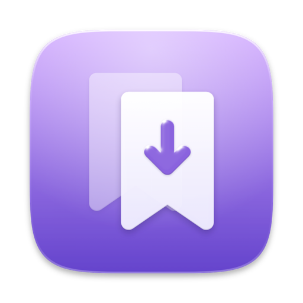
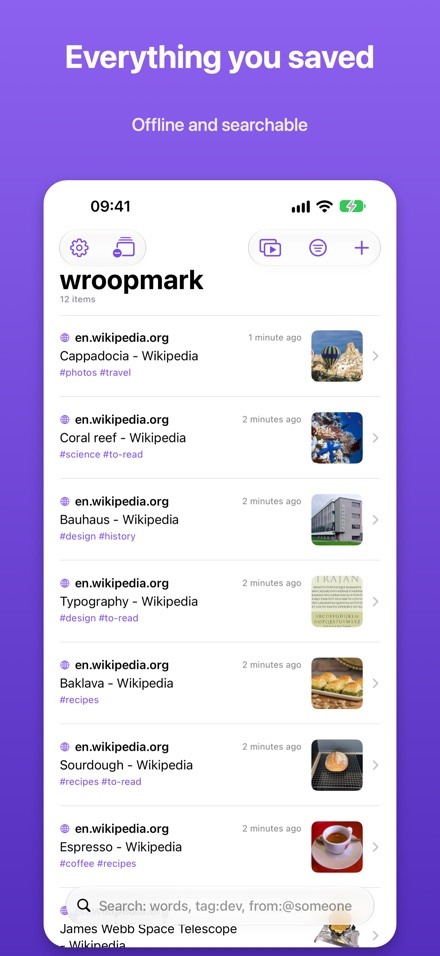
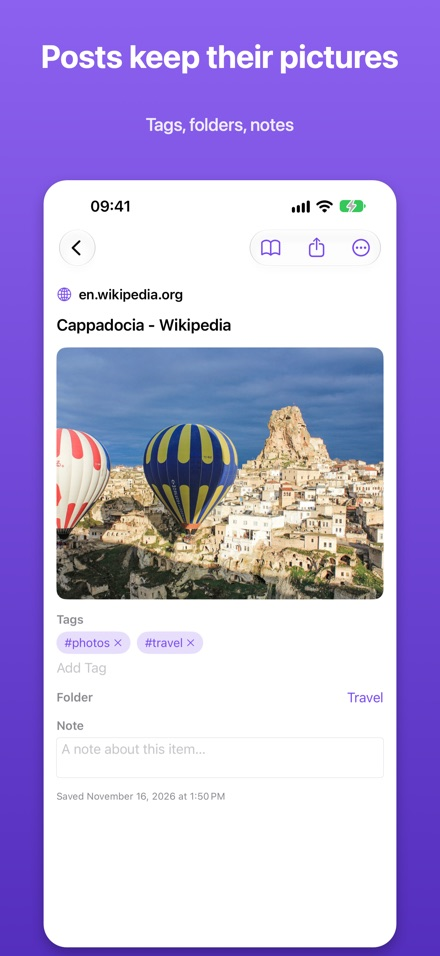
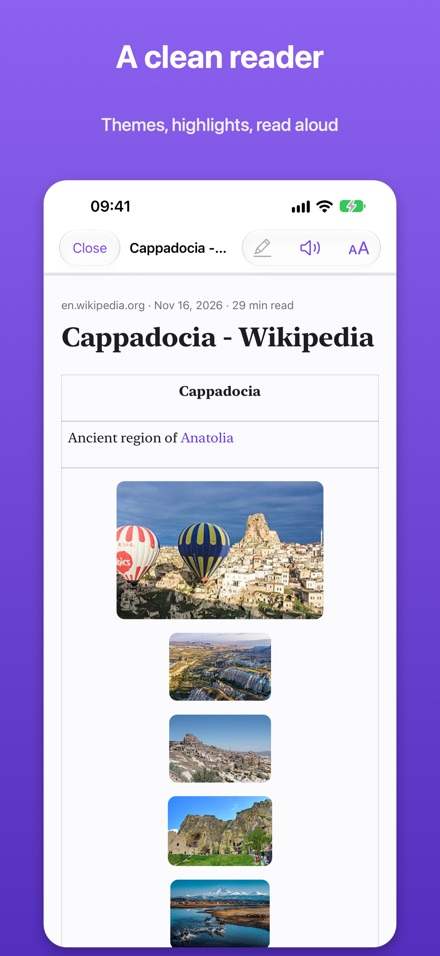
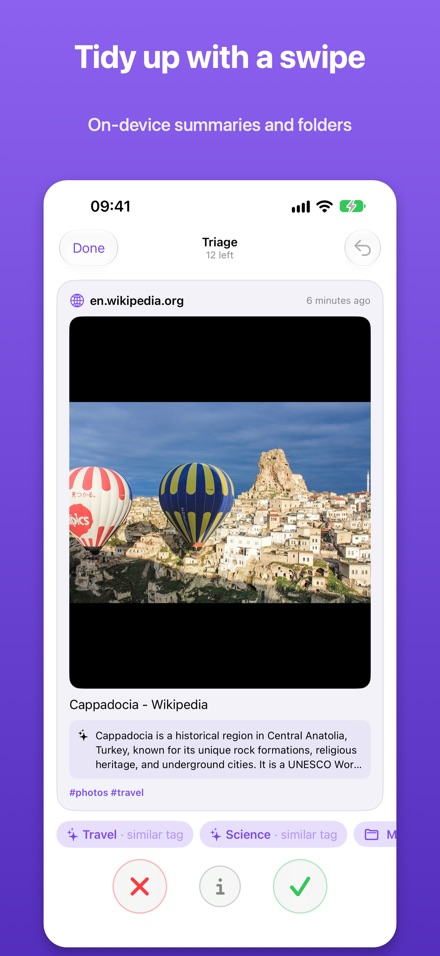

<p align="center">
  
</p>

<h1 align="center">wroopmark</h1>

<p align="center">
  <b>Your saved posts, videos and pages — offline, searchable, on your own devices.</b><br>
  An offline bookmark manager and read-later archive for Mac, iPhone and iPad.<br>
  <a href="https://github.com/f0rknturkoglu/wroopmark/releases/latest">Download for Mac</a> ·
  <a href="#install">Install</a> ·
  <a href="#features">Features</a> ·
  <a href="PRIVACY.md">Privacy</a> ·
  <a href="README.tr.md">Türkçe</a>
</p>

<p align="center">
  
  
  
  
</p>

---

You save things everywhere: X bookmarks, TikTok favorites, Instagram and Reddit
saved posts, YouTube Watch Later, Bluesky, Threads, articles. They live in five
apps, half of them can't be searched, and the post you want is gone the day its
author deletes it.

**wroopmark brings them into one archive that belongs to you.** The text, the
pictures and the videos are downloaded to your device, so they stay readable
offline and survive the original being deleted. Everything is searchable — even
the words inside screenshots and, with on-device AI, the meaning of a post.

No account. No server. No tracking. A Rust core with native SwiftUI apps, one
local SQLite library, and optional sync through your own iCloud Drive.

## Features

**Save from anywhere**
- **Share → wroopmark** in any iPhone or iPad app; the link is saved instantly
  and the text and pictures follow. Your own videos and photos go onto their post.
- **Browser extension** (Chrome, Brave, Arc, Edge, Vivaldi, Safari on Mac and
  iPhone): your X bookmarks, Instagram and Bluesky saved posts, TikTok
  favorites and YouTube lists flow in as you browse them.
- **Import** a TikTok, Instagram, X, Threads or Reddit data download (.zip),
  browser `bookmarks.html`, Pocket or Raindrop CSV, or videos and pictures from disk.
- X threads come in whole, with the replies around a post.

**Read and watch offline**
- A clean **reader** for articles and threads: themes, text size, read aloud,
  **highlights and notes** that sync and show up in search.
- A full-screen **feed** to scroll your saved videos and posts, TikTok-style,
  with picture-in-picture and AirPlay.
- A copy of every saved web page, readable even if the site goes away.

**Find anything**
- One search field with filters: `rust tag:dev from:@jack has:video after:2024 "exact phrase"`.
- Text in pictures (OCR) and the speech in your videos are searchable.
- **Search by meaning**, summaries and tag suggestions with Apple's on-device models — nothing leaves the device.
- Spotlight, Siri and Shortcuts: “Search wroopmark”, “Save to wroopmark”.

**Keep it tidy**
- Folders, nested tags (`reading/tech`), notes, saved searches, rules that file new saves.
- **Triage**: items come one by one — swipe to keep, delete or move to a suggested folder.
- Duplicates (same picture, same text, near-same meaning), a link pool with broken-link checks.
- “On this day” and a Home Screen and Lock Screen widget with something from your archive.

**Yours**
- Sync between Mac, iPhone and iPad through a folder in your own iCloud Drive.
- Export to Markdown (Obsidian-ready, with pictures), CSV, JSON, or a single
  offline HTML page you can send to anyone.
- An MCP server lets AI agents such as Claude search and read your archive, on your machine.

## Install

**Mac** (macOS 26+): download the signed and notarized `.dmg` from
[Releases](https://github.com/f0rknturkoglu/wroopmark/releases/latest) and drag
wroopmark to Applications. It updates itself, verifying every update's signature.
Or build from source:

```bash
git clone https://github.com/f0rknturkoglu/wroopmark.git
cd wroopmark && ./install.sh
```

**iPhone and iPad**: coming to the App Store. Until then, open
`apple/iOS/Wroopmark.xcodeproj` in Xcode and run it on your device (see
[README.tr.md](README.tr.md#iphone) for the steps). The app walks you through
the share sheet, the Safari extension and iCloud backup on first launch.

**Browser extension**: wroopmark → Settings → Extension shows the steps for
your browser; the Safari extension ships inside the app.

## How it compares

| | wroopmark | Read-later apps | Bookmark managers | Self-hosted archivers |
|---|:-:|:-:|:-:|:-:|
| Saves the post's pictures and videos | ✅ | — | — | some |
| Social saves (X, TikTok, Instagram, Reddit, Bluesky, Threads) | ✅ | — | links only | some |
| Works offline, survives deletion | ✅ | articles | — | ✅ |
| Search in pictures and video speech | ✅ | — | — | — |
| On-device AI (meaning search, summaries) | ✅ | cloud | cloud | external API |
| No account, no server | ✅ | — | — | needs a server |
| Native Mac, iPhone and iPad apps | ✅ | ✅ | ✅ | web |

## Privacy

wroopmark collects no data. Your archive stays on your devices and, if you
choose, in your own iCloud Drive. Text recognition, summaries and search by
meaning run on the device. See [PRIVACY.md](PRIVACY.md).

## For developers

- [ARCHITECTURE.md](ARCHITECTURE.md): the Rust core, sync design, roadmap.
- `core/`: Rust (SQLite + FTS5, extractors, sync, MCP). `cargo test` runs 68 tests;
  `WM_PERF_N=50000 cargo test --release --test perf -- --ignored --nocapture`
  times a 50 000-post library.
- `apple/`: the Mac app (SwiftPM), the iPhone/iPad app, widgets, share and Safari extensions.
- `extensions/chromium/`: the browser extension.

Screenshots show Wikipedia articles (text and images CC BY-SA 4.0) in a demo library.

## License

MIT © 2026 Furkan Türkoğlu
