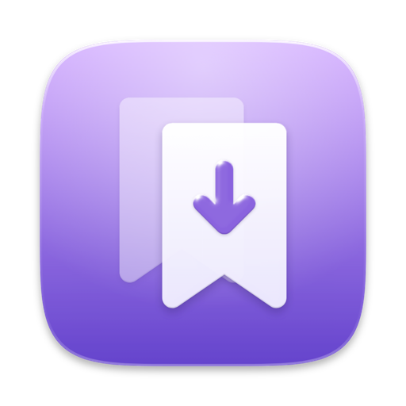
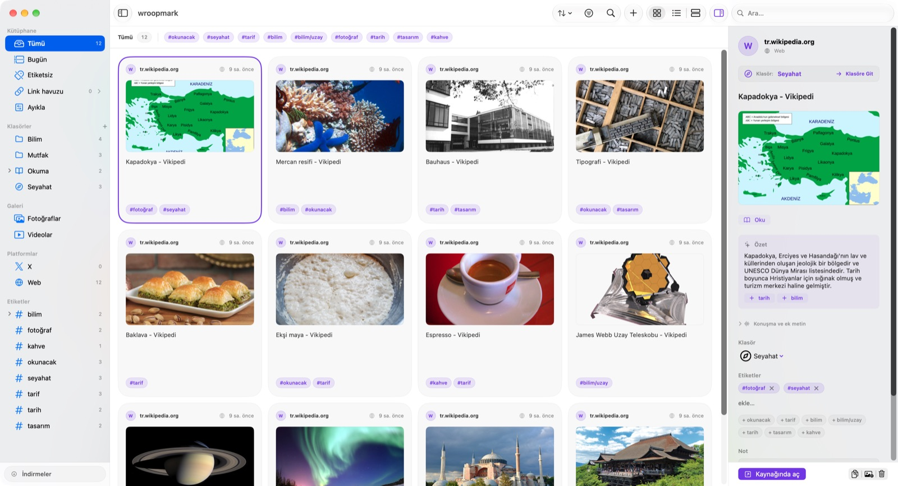
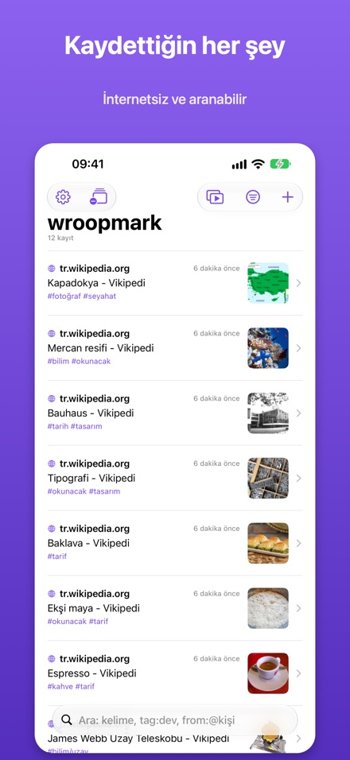
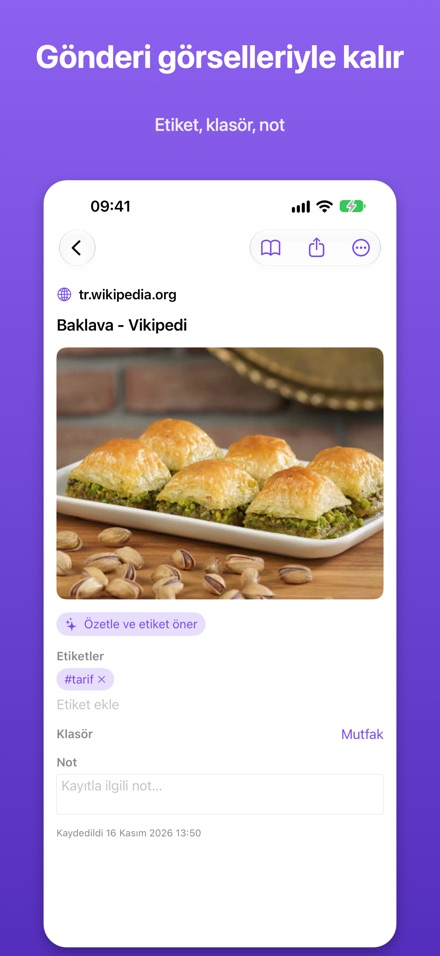
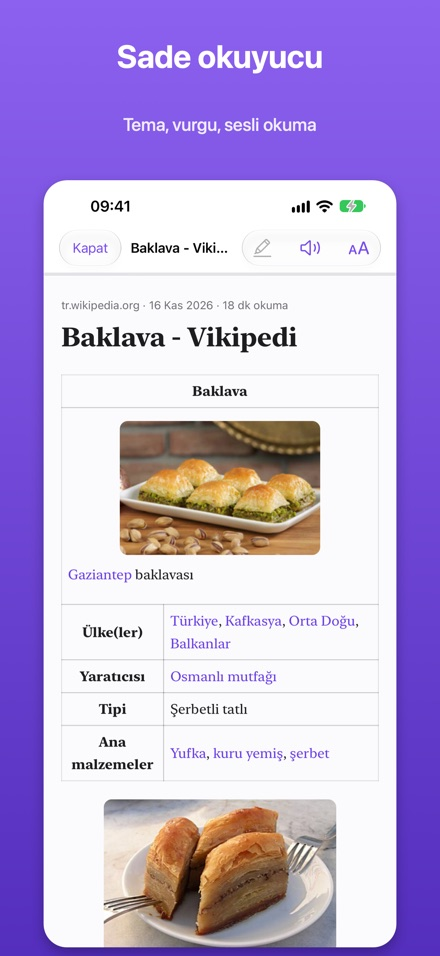
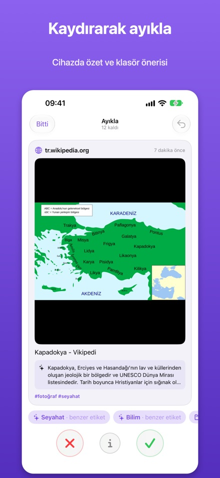

<p align="center">
  
</p>

<h1 align="center">wroopmark</h1>

<p align="center">
  Kaydettiklerin, çevrimdışı ve aranabilir. Mac, iPhone ve iPad için.<br>
  <a href="https://github.com/f0rknturkoglu/wroopmark/releases/latest">Mac için indir</a> ·
  <a href="#kurulum-macos-26">Kurulum</a> ·
  <a href="#kullanım">Kullanım</a> ·
  <a href="#hafif-ve-hızlı">Hafif ve hızlı</a> ·
  <a href="ARCHITECTURE.md">Mimari</a> ·
  <a href="README.md">English</a>
</p>

<p align="center">
  
</p>

<p align="center">
  
  
  
  
</p>

---

Sosyal medyada kaydettiklerin (X yer imleri, TikTok favorileri, Instagram,
Reddit ve Bluesky kaydedilenleri, YouTube "Daha Sonra İzle", herhangi bir web
sayfası) tek yerde, **çevrimdışı**
ve aranabilir. Metin, görseller, videolar ve linkler Mac'ine iner; gönderi
kaynağından silinse de arşivde kalır.

Sunucu, Docker, hesap yok. Rust çekirdeği + SwiftUI Mac, iPhone ve iPad
uygulamaları + Chromium/Safari eklentisi; hepsi tek bir yerel kütüphaneyi kullanır.
Ekran görüntüleri demo kütüphanedeki Wikipedia makaleleridir (CC BY-SA 4.0).

## Neler yapar

**Arşiv**
- X, TikTok, Instagram, Reddit, Bluesky, YouTube ve her web sayfası tek bir kayıt biçiminde.
- X zincirleri: zinciri bir kez açınca yazarın devam tweet'leri görselleriyle aynı kayda eklenir.
- Web sayfalarının kaydedildiği hâli saklanır (site değişse, kapansa da açılır) + okuma görünümü.
- Medya bir kez iner (aynı görsel iki gönderide olsa da); TikTok videoları
  yt-dlp ile arka planda.
- Görsellerdeki yazı cihazda okunur (Apple Vision), ekran görüntüleri de aranır.
- Toplu içe aktarma: tarayıcı yer imleri, TikTok / Instagram / X veri paketleri,
  Pocket / Raindrop CSV. Diskteki videolar ve görseller de (eski TikTok indirmelerin
  dosya adındaki numarayla gönderisine bağlanır).
- Dışa aktarma: Markdown (Obsidian'a hazır, görsellerle), CSV, JSON.
- Yedek: veritabanı + medya + düz bir dışa aktarım (`items.jsonl`), istenirse her gün.

**Bulmak**
- Tek arama kutusu: `rust tag:dev -from:@jack has:image after:2024 "tam ifade"`;
  Türkçe katlama ("istanbul" = "İSTANBUL" = "ıstanbul").
- **Anlamına göre arama** (✦): birebir geçmese de aynı şeyden bahseden kayıtlar.
  Cihazdaki dil modeli aramayı eş anlamlılarla genişletir, her kaydın anlam
  vektörüne bakılır. İnternete bir şey gitmez.
- Filtre paneli (platform, medya, klasör, etiket, kişi, site, tarih…), kayıtlı aramalar.
- Spotlight'ta da çıkar; seçince kayıt uygulamada açılır.
- Kart, liste, akış görünümleri; foto ve video galerisi.

**Düzen**
- Klasörler (alt klasörlerle), hiyerarşik etiketler (`dev/rust`), notlar.
- Ayıkla: kayıtlar tek tek gelir, ← sil, → sakla, 1–3 önerilen klasöre taşı;
  her kartın kısa özeti ve etiket önerileri cihazda çıkar, tek tıkla eklenir.
- Kurallar: `site:github.com` → `#dev/github`, `from:@kişi` → klasör… yeni gelen her şeye uygulanır.
- Kopyalar: aynı görsel/video, aynı metin ya da anlamca aynı kayıtlar; birini tut.
- Her kaydın yanında anlamca benzerleri.
- Link havuzu: gönderilerdeki tüm linkler tekilleştirilmiş, kırık olanlar işaretli.

**Cihazlar arası**
- Senkron: iCloud Drive (ya da Syncthing, Dropbox…) klasörü üzerinden; sunucu, hesap yok.
  Kayıtlar, etiketler, klasörler, notlar, kayıtlı aramalar ve görseller gider.

**Ajanlar**
- MCP sunucusu: Claude, Cursor gibi ajanlar arşivinde arar, kayıtları okur, etiketler.
- Kısayollar, Siri ve Apple Intelligence: "wroopmark'ta ara", "wroopmark'a kaydet", "wroopmark'ta bul".

**Hızlı kayıt**
- Menü çubuğundan link kaydet; her uygulamada ⌃⌥⌘S panodaki linki kaydeder.
- Eklentide ⌥⇧S, sağ tıkla klasöre kaydet; arşivdeki sayfalarda simgede ✓.

## Hafif ve hızlı

Kutuya konmuş bir tarayıcı değil, yerel bir uygulama: Electron yok, arka plan
servisi yok, sıcak tutulan bir web motoru yok. Mac uygulaması açık dururken sen
kullanmıyorsan **hiç işlemci kullanmaz**. Görsellerde yazı tanıma ve cihazdaki
yapay zekâ küçük yardımcı süreçlerde, yalnızca iş varken çalışır; Ayarlar'dan
duraklatılır.

| Mac'te ölçülen (M4 Pro, macOS 27.2, wroopmark 1.7.0) | |
|---|--:|
| İşlemci, pencere açık, boşta: 50.000 gönderilik kütüphane ve bir günlük kullanımdan sonra gerçek bir arşiv | **%0,0** |
| Bellek, 50.000 gönderi, pencere açık | **~110 MB** |
| Bellek, bir günlük kullanımdan sonra, ekran görsellerle dolu | **~280 MB** |
| Kütüphaneyi açma | **5 ms** |
| En yeni gönderilerin ilk sayfası | **0,6 ms** |
| 50.000 gönderide kelime ya da öbek araması | **7–21 ms** |
| Süzgeçler (`platform:x has:video tag:…`, `from:@…`, klasörler) | **3–32 ms** |
| İndirme / kurulu uygulama | **15 MB / 29 MB** |

Bellek sistemin "footprint" değeri; işlemci bir dakika boyunca `top`. Dürüst
olmak gerekirse: büyük bir içe aktarmadan sonra kütüphane bir kez arka planda
dizinlenir (görsellerdeki yazı, anlamına göre arama) ve bitene kadar işlemci
kullanır. Süreler bu deponun kendi testinden, kendin de bakabilirsin:
`WM_PERF_N=50000 cargo test --release --test perf -- --ignored --nocapture`.

## iPhone

`apple/iOS/Wroopmark.xcodeproj`: arşivi telefonda aramak, okumak, etiketlemek, not
almak ve telefondan kaydetmek için. Mac'le iCloud Drive senkronu üzerinden konuşur.

**Telefona kurmak** (ücretsiz Apple hesabı yeter, bir kez):

1. Rust'ın iOS hedefleri: `rustup target add aarch64-apple-ios aarch64-apple-ios-sim`
2. `open apple/iOS/Wroopmark.xcodeproj`
3. Xcode → Wroopmark hedefi → **Signing & Capabilities** → **Team**: kendi Apple
   hesabın (yoksa Xcode → Settings → Accounts'tan ekle). Bundle id'yi başka biri
   kullanıyorsa sonuna bir şey ekle (`…wroopmark.ios.furkan`).
4. iPhone'u kabloyla bağla, üstte cihaz olarak seç, **Çalıştır** (⌘R). Rust çekirdeği
   ilk seferde derlenir (birkaç dakika).
5. iPhone: Ayarlar → Genel → VPN ve Cihaz Yönetimi → geliştirici uygulamasına güven;
   ilk seferde Ayarlar → Gizlilik ve Güvenlik → **Geliştirici Modu**'nu aç.

Ücretsiz hesapla kurulan uygulama 7 günde bir yeniden kurulmalı (Xcode'dan yine
⌘R, verin silinmez); AltStore / SideStore bunu kendiliğinden yapar.

**İlk açılış**: Mac'te Ayarlar → Senkron → iCloud Drive ile başlat; telefonda Ayarlar
(dişli) → Klasörü seç → iCloud Drive → `wroopmark`. Kütüphane telefona iner; sonra
her açılışta ve aşağı çekince eşitlenir.

**Telefondan kaydetmek**: her uygulamada **Paylaş → wroopmark** (ilk seferde paylaşım
listesinde "Diğer"den ekle). Bağlantı anında kaydedilir, istersen etiket ve not
eklersin; metin ve görseller wroopmark açılınca gelir. Kısayollar'da da
"wroopmark'a Kaydet" eylemi var.

## Kurulum (macOS 26+)

### Tek komut

```bash
git clone https://github.com/f0rknturkoglu/wroopmark.git
cd wroopmark
./install.sh
```

Betik eksikleri kendisi tamamlar ve sorarak ilerler:

1. Xcode Command Line Tools yoksa kurulum penceresini açar (bitince betiği yeniden çalıştır).
2. Rust yoksa [rustup](https://rustup.rs) ile kurar.
3. Uygulamayı derleyip `/Applications/wroopmark.app` olarak kurar (açıksa önce kapatır).
4. `wroopmark` terminal komutunu ekler.
5. İstersen TikTok video araçlarını (yt-dlp, gallery-dl) kurar.
6. Uygulamayı açar ve eklenti adımlarını gösterir.

Soru sormadan kurmak için `./install.sh --yes`.

### Hazır paket

[Releases](https://github.com/f0rknturkoglu/wroopmark/releases) sayfasındaki
`.dmg`'yi aç, wroopmark'ı Applications'a sürükle. v0.6'dan itibaren paketler
Developer ID ile imzalı ve Apple onaylı (notarized): uyarısız açılır.

Daha eski bir paket ilk açılışta engellenirse: Sistem Ayarları → Gizlilik ve
Güvenlik → **Yine de aç**, ya da bir kez:

```bash
xattr -dr com.apple.quarantine /Applications/wroopmark.app
```

### Tarayıcı eklentisi

**Chrome, Brave, Arc, Edge, Vivaldi, Helium:** wroopmark → Ayarlar → Eklenti →
tarayıcının düğmesine bas. Eklentiler sayfası ve eklenti klasörü açılır, yol
panoya kopyalanır. Sonra:

1. Sağ üstte **Geliştirici modu**'nu aç.
2. **Paketlenmemiş öğe yükle** → `~/Library/Application Support/wroopmark/chromium-extension`

Eklenti uygulamayla gelir. Uygulama güncellenince bu klasör de güncellenir;
eklentide ↻ (yeniden yükle) yeterli. Tarayıcıyla bağlantıyı uygulama kendisi
kurar.

**Safari:** uygulamanın içinde gelir. Ayarlar → Eklenti → **Safari'de aç**.
İmzasız kurulumda önce Safari → Ayarlar → Geliştirici → "İmzasız eklentilere
izin ver" (Safari bunu her açılışta sıfırlar; Xcode'da bir "Apple Development"
sertifikası varsa derleme onunla imzalar ve bu adım gerekmez).

### Güncelleme ve kaldırma

```bash
git pull && ./install.sh      # güncelle (sonra eklentide ↻)
./install.sh --uninstall      # uygulamayı kaldır; kütüphane yerinde kalır
```

Kütüphane: `~/Library/Application Support/wroopmark/` (veritabanı + `media/`).

## Kullanım

### Kaydetme

| Nereden | Nasıl |
|---|---|
| X yer imleri | Eklenti açıkken `x.com/i/bookmarks`'ı kaydır (ya da popup → Otomatik Kaydır), popup → Aktar. Yer imine eklediğin tweet de kuyruğa girer. |
| TikTok | Profil → Favoriler / Beğenilenler'i kaydır, popup → Aktar. Videolar yt-dlp ile ya da sayfanın içinden iner. |
| Instagram | Profil → Kaydedilenler'i kaydır (popup'taki düğme oraya götürür), popup → Aktar. |
| X zincirleri ve yanıtlar | Kaydettiğin bir tweet'in konuşmasını x.com'da aç; yazarın devam tweet'leri ve gelen yanıtlar o kayda eklenir. |
| YouTube | youtube.com'da popup → **Daha Sonra İzle'yi aç**, listeyi kaydır. Beğendiğin videolar için `playlist?list=LL`. Videolar inmez; kapak, başlık, kanal kalır. |
| Bluesky | bsky.app'te popup → **Bluesky kaydedilenleri aç**, kaydır ya da gönderiyi yer imine ekle. Profilindeki Beğeniler sekmesi de aynı şekilde. |
| Threads | threads.com'da popup → **Threads kaydedilenleri aç** ya da `/saved` sayfasını kaydır; ayrıca Instagram/Threads veri paketinden (`saved_threads.json`, `liked_threads.json`) içe aktarılır. |
| Reddit | reddit.com'da popup → **Reddit kaydedilenlerini aktar** ya da Reddit veri paketinden (`saved_posts.csv`, `saved_comments.csv`, `post_votes.csv`). |
| Herhangi bir sayfa | Popup → Kaydet (etiket, not, klasör), ⌥⇧S, ya da sağ tık → wroopmark'a kaydet / klasöre kaydet. |
| Uygulamadan | ⌘N, linki pencereye sürükle-bırak, menü çubuğu simgesi, her yerde ⌃⌥⌘S (panodaki link). iPhone/iPad'de **+** veya **Ayarlar → Dosyalardan içe aktar**. |
| Veri paketi, yer imleri | ⇧⌘I ya da dosyayı pencereye bırak (iPhone'da Ayarlar → Dosyalardan içe aktar): `bookmarks.html`, TikTok / Instagram / Threads / X / Reddit veri paketi (.zip ya da klasör), Pocket / Raindrop CSV. Çoğu yalnızca link verir; metin, yazar ve medya arka planda gelir. İzleme geçmişi alınmaz. |
| Diskteki dosyalar | Video ve görselleri (ya da klasörü) pencereye bırak. Adında TikTok numarası olan video (`7194…​.mp4`, `SnapTik…_7194….mp4`) o gönderiye bağlanır; yt-dlp adları (`Başlık [id].mp4`) YouTube'a. |

### Arama

| Yazım | Anlamı |
|---|---|
| `kelime "tam ifade" -hariç` | metin (başlık, gövde, not, görseldeki yazı) |
| `tag:dev` `-tag:okundu` | etiket (alt etiketler dahil: `dev` → `dev/rust`) |
| `from:@jack` `-@jack` | kişi |
| `platform:x` `platform:tiktok` | platform |
| `has:image` `has:video` `has:link` `has:note` `has:ocr` `has:quote` `has:highlight` `has:thread` `has:reply` | içerik |
| `folder:ders` `is:unfiled` `is:infolder` | klasör (alt klasörler dahil) |
| `is:untagged` `is:tagged` `is:reviewed` | durum |
| `after:2024-01` `before:2025` `savedafter:` `savedbefore:` | paylaşılma / kaydedilme tarihi |
| `site:github.com` | gönderinin adresi ya da içindeki bir link o sitede |
| `is:stub` | yalnızca linki bilinen (içe aktarılmış, ayrıntısı gelmemiş) |
| `id:x:123` | tam o kayıt |

Her süzgeç `-` ile tersine döner. Filtre paneli de yalnızca bu terimleri üretir.

**Anlamına göre** (arama kutusunun yanındaki ✦, ⇧⌘M): "yazılımcı olarak iş bulmak"
yazınca içinde bu kelimeler geçmeyen mülakat, kariyer gönderileri de gelir. Süzgeçler
(etiket, tarih…) aynen çalışır. Apple Intelligence açık bir Mac'te en iyisi; değilse
yalnızca anlam vektörleri kullanılır.

### Kısayollar

| Kısayol | |
|---|---|
| ⌘N | Link ekle |
| ⌘1 / ⌘2 / ⌘3 | Kart / liste / akış |
| ⌥⌘F | Filtreler |
| ⌘⇧S | Aramayı kaydet |
| ⌘⇧T | Seçilenleri etiketle |
| ⌘⌫ | Seçilenleri sil |
| ⌘⇧K | Ayıkla (← sil, → sakla, ⌘Z geri al, 1–3 önerilen klasör) |
| ⇧⌘M | Anlamına göre aramayı aç / kapat |
| ⇧⌘I | İçe aktar |
| ⌘J | İndirmeler |
| ⌃⌥⌘S | Her yerde: panodaki linki kaydet |
| ⌥⇧S / ⌥⇧W | Tarayıcıda: sayfayı kaydet / popup (`chrome://extensions/shortcuts`) |

### Sayfa kopyaları

Kaydettiğin her web sayfası (makale, GitHub, arXiv…) görünmez bir tarayıcıda açılıp
`.webarchive` olarak saklanır; detaydaki **Sayfanın kopyası** onu kaydedildiği hâliyle
açar, **Okuma** sekmesi yalnızca metni gösterir. Sayfadaki metin aramaya da girer.
Ayarlar → Medya'dan kapatılabilir.

### Kısayollar ve Siri

Kısayollar uygulamasında wroopmark eylemleri: **wroopmark'ta Ara** (uygulamada açar),
**wroopmark'a Kaydet** (bağlantı + etiketler, paylaşım menüsünden de), **wroopmark'ta Bul**
(sonuçları başka kısayollara verir; anlamına göre de arayabilir). Siri'ye
"wroopmark'ta ara" demek de olur.

### Senkron

Ayarlar → Senkron → **iCloud Drive ile başlat** (ya da başka bir klasör). İlk seferde
kütüphane klasöre yazılır; diğer cihazda aynı klasörü seçince hepsi gelir. Sonrasında
değişiklikler birkaç saniye ile bir dakika içinde karşıya geçer.

- Veritabanı klasöre konmaz; her cihaz yalnızca kendi değişiklik günlüğüne ekler
  (`ops/<cihaz>/<ay>.jsonl`), diğerlerininkini okur.
- Aynı kaydın farklı şeylerini iki cihazda değiştirirsen (birinde etiket, öbüründe not)
  ikisi de kalır; aynı şeyi değiştirirsen son yapılan geçerli olur.
- Medya: görseller klasöre kopyalanır (önerilen); videolar her cihazda kendi iner.
  "Görseller ve videolar" seçilirse videolar da gider (GB'larca yer tutabilir).
- Terminalden: `wroopmark sync`, `wroopmark sync status`.

### Kurallar

Ayarlar → Kurallar: bir arama yaz (`site:github.com`, `from:@karpathy`,
`platform:tiktok has:video`, `"yapay zeka"`…), uyan kayda eklenecek etiketi ve/veya
klasörü seç. Yeni kaydedilen ya da içe aktarılan her şey kurallardan geçer; istersen
mevcut kayıtlara da uygulanır. Elle seçtiğin klasör kuralı ezer.

### Dışa aktarma

Dosya → Dışa aktar: ekrandaki görünüm ve arama (her şey için Tümü) Markdown, CSV ya da
JSON olarak. Markdown her kaydı ön bilgili (yazar, tarih, etiketler, kaynak) ayrı bir
not yapar, görseller `media/` altına kopyalanır; Obsidian kasasına doğrudan konur.

### Ajanlar (MCP)

Ayarlar → Ajanlar'daki satırı kopyala ya da:

```bash
claude mcp add wroopmark -- /Applications/wroopmark.app/Contents/Helpers/wroopmark mcp
```

Claude Desktop / Cursor için `command`: aynı yol, `args`: `["mcp"]` (yalnızca okuma:
`["mcp", "--read-only"]`). Araçlar: `search` (süzgeçler + anlamsal), `get_item`
(tam metin, görseldeki yazı, medya dosya yolları), `related`, `search_links`,
`list_tags`, `list_folders`, `stats`, `save_url`, `tag_items`, `move_to_folder`,
`set_note`. Her kayıt ayrıca `wroopmark://item/<id>` kaynağı olarak Markdown biçiminde
okunabilir. Sunucu ajanla birlikte açılıp kapanır.

### Yedek ve geri yükleme

Ayarlar → Yedek → bir klasör seç (harici disk, senkronlanan klasör…). İçinde
`wroopmark-yedek/` oluşur: `library.sqlite`, `media/`, `items.jsonl`
(her satır bir kayıt; başka programlar için). İlk yedek her şeyi, sonrakiler
yalnızca yenileri kopyalar. Geri yüklemek: uygulamayı kapat, `library.sqlite`
ve `media/`'yı kütüphane klasörüne kopyala, aç.

### Bağlantılar

`wroopmark://item/<id>` (kaydı aç), `wroopmark://search?q=tag:dev`,
`wroopmark://add?url=https://…` (kaydet). Kısayollar uygulamasından ya da
başka araçlardan kullanılabilir.

### Terminal

```bash
wroopmark search "tag:dev rust"
wroopmark search -m "veritabanı performansı"        # anlamına göre
wroopmark add https://example.com/yazi --tag okunacak
wroopmark import ~/Downloads/tiktok-verilerim.zip
wroopmark import-files ~/Movies/TikTok
wroopmark export ~/Obsidian/Kasa/wroopmark tag:dev
wroopmark rule-add site:github.com -t dev/github --apply
wroopmark stats
```

`WROOPMARK_HOME=/bir/klasör` başka bir kütüphaneyle çalışır.

## Sorun giderme

- **Eklenti "bağlı değil" diyor:** uygulamayı bir kez aç; olmazsa Ayarlar →
  Eklenti → Bağlantıyı yenile, sonra eklentide ↻. Eklenti kimliği
  `kdkgliladllpidmnacdcackcamaknlej` olmalı.
- **Eklentinin ne yaptığını görmek:** `~/Library/Application Support/wroopmark/host.log`.
- **TikTok videoları inmiyor:** Ayarlar → Medya'da "Harici video indirici" yeşil
  olmalı (`./install.sh` kurar). Olmazsa video, gönderi tarayıcıda açılınca iner.
- **Anlamsal arama / özet çalışmıyor:** Ayarlar → Zeka'da iki modelin durumu yazar.
  Özet için Apple Intelligence açık olmalı (Sistem Ayarları → Apple Intelligence ve Siri).
  Anlam dizini ilk açılışta arka planda oluşur (1600 kayıt ~20 sn).
- **Safari eklentisi listede yok:** "İmzasız eklentilere izin ver"i aç
  (Safari her açılışta kapatır).

## Geliştirme

| Yol | Ne |
|---|---|
| `core/` | Rust çekirdek: SQLite + FTS5, ayrıştırıcılar, medya deposu, JSON API, CLI / native host |
| `apple/` | SwiftUI macOS uygulaması, OCR ve zeka yardımcıları (`apple/OCR`, `apple/AI`), Safari eklentisinin native tarafı |
| `extensions/chromium/` | MV3 eklenti (Safari sürümü de buradan üretilir) |
| `install.sh` | kaynaktan kurulum / kaldırma |
| `apple/scripts/build-mac.sh` | uygulamayı derler (`--install` ile /Applications'a koyar) |
| `apple/scripts/package.sh` | `dist/` altına `.zip` + `.dmg` |

```bash
cd core && cargo fmt --check && cargo clippy --all-targets -- -D warnings && cargo test
apple/scripts/build-mac.sh --install
```

Sürüm çıkarmak: `core/Cargo.toml`'daki sürümü artır, commit'le, sonra
`apple/scripts/release.sh`. Etiketi gönderir, imzalı + Apple onaylı `.dmg` / `.zip`
üretip GitHub release'ine koyar. Bir kez gerekenler: "Developer ID Application"
sertifikası ve `xcrun notarytool store-credentials wroopmark` ile kaydedilmiş onay
profili. (GitHub Actions'taki `release` işi yalnızca elle çalıştırılan, imzasız bir
derleme denetimi.)

Mimari ve tasarım kararları: [ARCHITECTURE.md](ARCHITECTURE.md).

## Lisans

[MIT](LICENSE)
